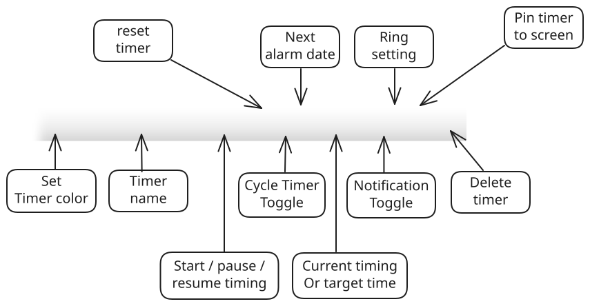

The diagram below labels every button and area on the toolbar, using one timer as an example:

## Buttons and areas

- **Set timer color**: sets the timer's color so you can tell timers apart.
- **Timer name**: shows the timer's name; click to rename it, e.g. "Kitchen timer" or "Meeting timer".
- **Start / pause / resume timing**: controls the timer's running state.
- **Reset timer**: returns the timer to its initial state.
- **Cycle timer toggle**: when on, a countdown restarts automatically after it reaches zero — ideal for repeating cycles.
- **Current timing or target time**: shows the elapsed time, or the countdown's target and remaining time.
- **Notification toggle**: controls whether a pop-up notification appears when time is up.
- **Ring setting**: sets whether a ringtone plays when time is up, and which one.
- **Pin timer to screen**: pins the timer on top of your screen or unpins it — see [On-top Pinning Help](topmost-reminder-pin/).
- **Delete timer**: deletes the current timer.

## Mode buttons

The row of round buttons at the far left of the toolbar creates timers of each mode: **Countdown**, **Timer**, **Stopwatch** and **Alarm** — click one to create it.
