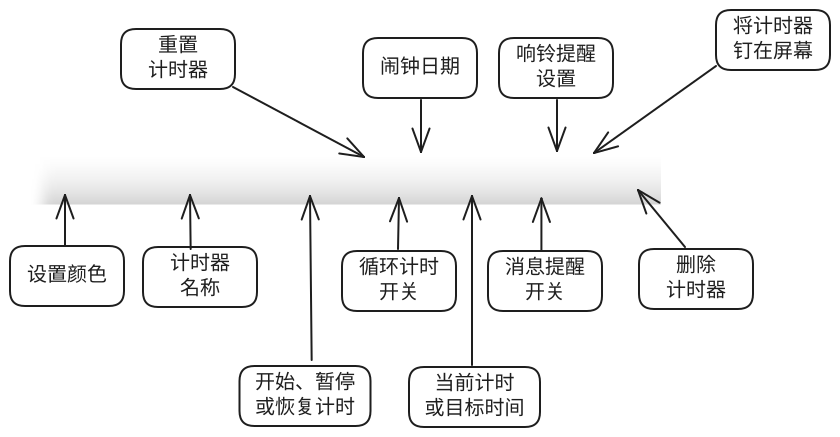

下图以一个计时器为例，标出了工具条上各个按钮和区域的含义：

## 按钮与区域说明

- **设置颜色**：点击后设置该计时器的颜色，便于在多个计时器之间区分。
- **计时器名称**：显示当前计时器的名称，点击可以重命名，例如「厨房计时」「会议计时」。
- **开始、暂停或恢复计时**：控制该计时器的运行状态。
- **重置计时器**：将计时器恢复到初始状态。
- **循环计时开关**：打开后，倒计时结束后会自动重新开始，适合周期性重复的任务。
- **当前计时或目标时间**：显示正在累计的时间，或倒计时的目标时间与剩余时间。
- **消息提醒开关**：控制到点时是否弹出消息通知。
- **响铃提醒设置**：设置到点时是否播放铃声以及铃声选项。
- **将计时器钉在屏幕**：将计时器钉在屏幕最前面或取消，详见[屏幕置顶帮助](topmost-reminder-pin/)。
- **删除计时器**：删除当前计时器。

## 类型按钮

工具条最左侧的一排圆形按钮用于创建不同类型的计时器：**倒计时**、**计时器**、**秒表**和**闹钟**，点击即可新建。
