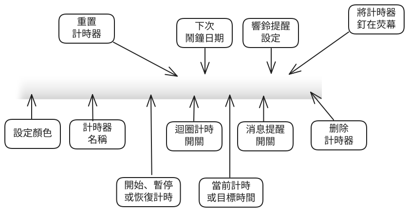

下圖以一個計時器為例，標出了工具條上各個按鈕與區域的含義：

## 按鈕與區域說明

- **設定顏色**：點擊後設定該計時器的顏色，便於在多個計時器之間區分。
- **計時器名稱**：顯示目前計時器的名稱，點擊可以重新命名，例如「廚房計時」「會議計時」。
- **開始、暫停或恢復計時**：控制該計時器的執行狀態。
- **重置計時器**：將計時器恢復到初始狀態。
- **循環計時開關**：開啟後，倒數結束後會自動重新開始，適合週期性重複的任務。
- **目前計時或目標時間**：顯示正在累計的時間，或倒數的目標時間與剩餘時間。
- **訊息提醒開關**：控制到點時是否彈出訊息通知。
- **鈴聲提醒設定**：設定到點時是否播放鈴聲以及鈴聲選項。
- **將計時器釘選在畫面**：將計時器釘選在畫面最上層或取消，詳見[螢幕置頂幫助](topmost-reminder-pin/)。
- **刪除計時器**：刪除目前的計時器。

## 類型按鈕

工具條最左側的一排圓形按鈕用於建立不同類型的計時器：**倒數計時**、**計時器**、**碼錶**與**鬧鐘**，點擊即可新增。
